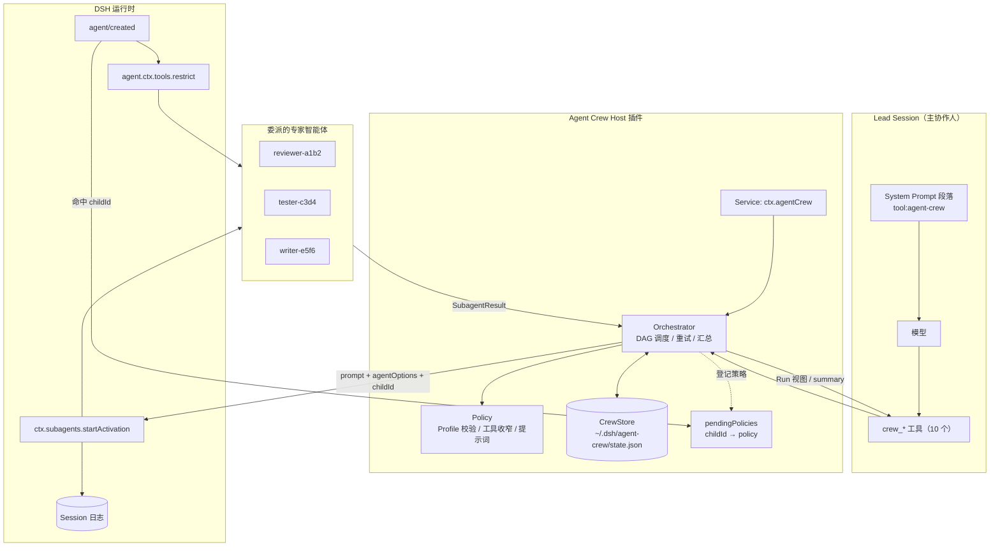
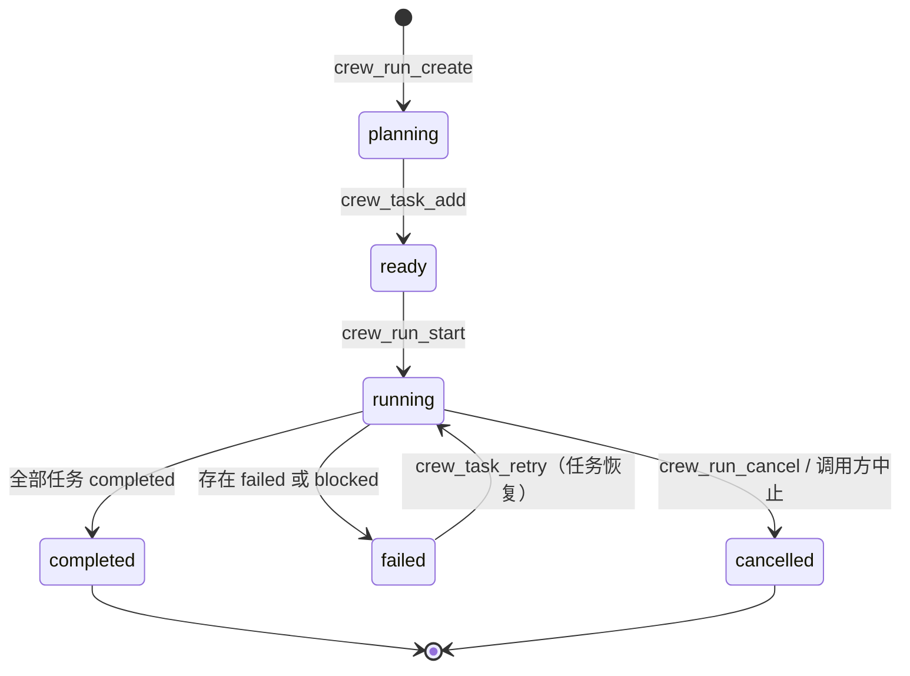
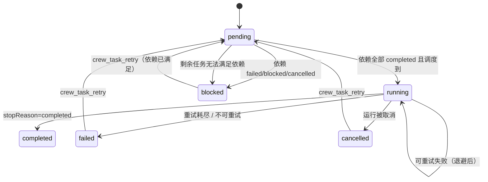
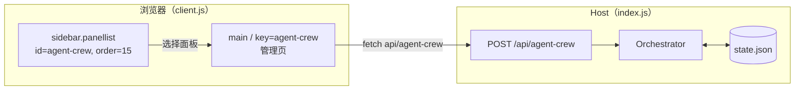
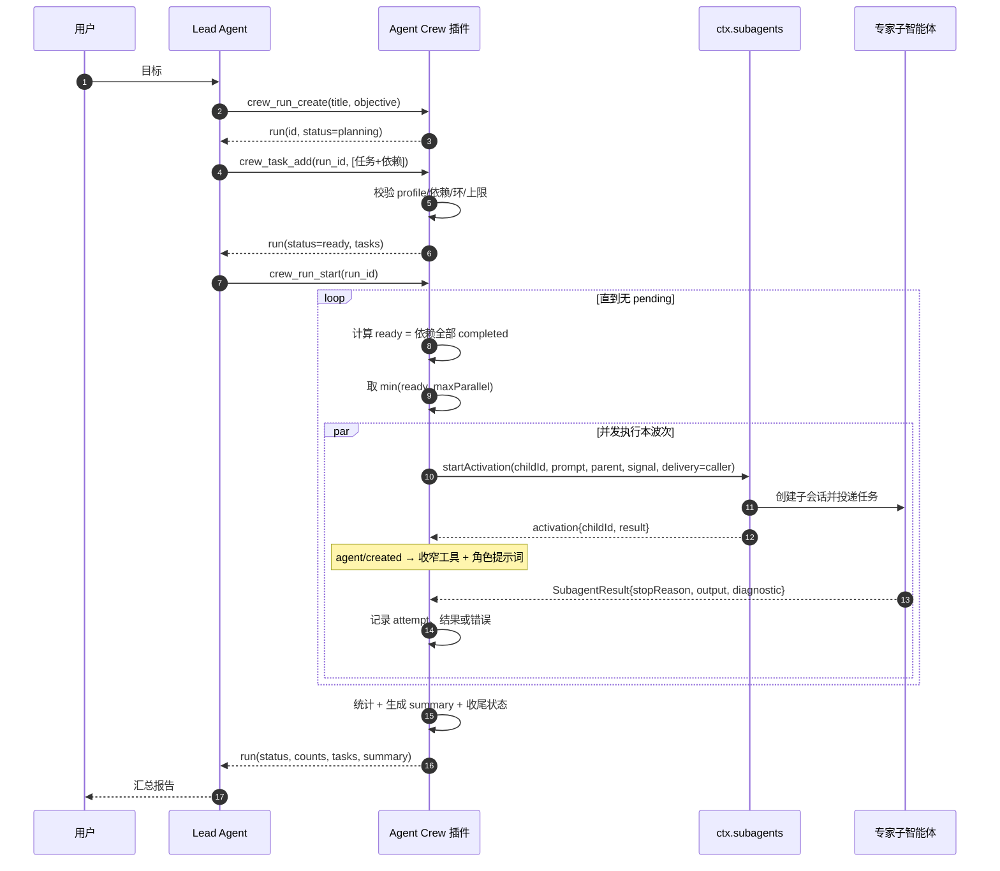

# Agent Crew：DSH 多智能体协作插件架构设计

> 目标版本：DSH `0.2.2-rc.2`（`@deepseek-ai/dsh`）
> 插件包：`@local/dsh-agent-crew`
> 设计参考：[OpenMausBot](https://github.com/milind-soni/OpenMausBot) 的「Bot 花名册 + Chief of Staff（主协作人）+ 任务/团队模板 + 无人值守编排」思路

---

## 1. 背景与目标

OpenMausBot 把「一个助手」变成「一支团队」：每个 Bot 拥有自己的角色、模型、可用工具与运行环境，由 Chief of Staff 负责拆解目标、分派工作、跟踪进度。它给 DSH 的可借鉴点有五条：

| OpenMausBot 概念 | 可迁移的设计要点 | 本插件对应实现 |
|---|---|---|
| Bot 花名册 | 每个智能体是可复用、可编辑的持久定义 | Agent Profile（角色/指令/能力/工具/模型路由/重试上限） |
| 每个 Bot 独立模型与工具 | 按智能体收窄能力面 | `agentOptions` 路由覆盖 + 子智能体作用域内 `tools.restrict()` |
| Chief of Staff | 主协作人拆解、委派、汇总 | Lead Session 侧编排工具 + 任务 DAG |
| 任务 / 运行记录 | 可追踪的任务状态与产出 | Run / Task / Attempt 三级状态机与结果汇总 |
| 头less 团队运行 | 一次调用跑完一整队 | `crew_run_start` 同步执行到收敛后返回汇总 |

在 DSH 侧要实现的是**标准化插件**，而不是再造一套 Agent 运行时。因此插件严格复用 DSH 已有的协作原语，只补齐三块缺失能力：

1. **可复用的智能体定义**（DSH 的 subagent 是无状态委派；角色与工具组合需要每次在提示词里重复，或依赖 Agent Preset 的静态 YAML）。
2. **任务级编排**（DSH 的 `subagent` 工具一次只委派一个任务；`agentTeams` 提供共享任务板但由模型自行 claim，没有自动依赖调度与失败传播）。
3. **可审计的运行视图**（跨任务的 attempt、错误码、汇总报告）。

---

## 2. 现状：DSH 0.2.2-rc.2 的协作原语

以下事实来自运行中安装包（`cordis_inspect_query` 与包源码），不是推测。

### 2.1 `ctx.subagents`：委派接缝

- `startActivation(spec)` 返回 `{ childId, name, messageId?, result, dispose }`；
  `spec` 包含 `provider / label / name? / childId? / prompt / parent / signal / delivery / agentOptions? / agentPreset? / maxDepth?`。
- Provider 注册制：`spawn`（全新子会话）、`fork`（继承已完成轮次）、ACP/SDK/Codex 等外部后端。
- `delivery: 'parent'` 会在父会话产生完成通知；`delivery: 'caller'` 只把结果交给调用方，不打扰父会话——**适合编排器聚合**。
- 子智能体具备 `agentPreset`、`agentOptions`、`depthLimit`、`outputSchema` 能力位；`spawn` 全部支持。
- 名称规则：`1–32` 个小写字母/数字/连字符，首字母必须是字母，`lead` 保留；同一 creator 的兄弟名不可复用。
- `interrupt(sessionId, { kind: 'ancestor', agent })` 可按祖先权限打断子树执行。
- 容量：`maxActiveSubagents` 默认 8，按子智能体树共享。

### 2.2 `agent/created` 与作用域工具策略

- Agent 创建完成、首次提示词装配之前，会串行派发 `agent/created`（`{ agent, source, signal? }`）。
- `agent.ctx` 是该 Agent 的隔离上下文；在其上注册 `tools.restrict({ allow | deny })` 只影响该 Agent，且随 Agent 销毁自动回滚。
- `restrict()` 要求名单中的工具在全局作用域存在，否则注册失败——所以必须先与 `ctx.tools.definitions()` 求交集。

### 2.3 其余相关机制

| 机制 | 作用 | 本插件如何使用 |
|---|---|---|
| Agent Preset | 用 YAML 定义子智能体的插件组合（人格、工具） | 不强制；`Provider` 可换成 preset 驱动的组合。插件用运行期策略补足「按任务动态收窄」 |
| `agentTeams` | Lead 日志支撑的共享任务板（CAS 认领/完成） | 不与 crew 任务表竞争：crew 的 DAG 由编排器独占调度；需要人工/多成员认领时仍可用 Team 板 |
| Session 日志 | 唯一持久事实源（供 fork/resume/replay） | crew 的子会话就是普通 subagent 会话，模型看到的内容全部可从日志重建 |
| `sessionProjections` | 由日志派生投影 | 本插件不注册 projection，避免与 Session 格式耦合；运行状态是插件自有数据 |
| `storageDomain` | schema 校验的 KV 域 | 可选演进方向；当前使用单文件 JSON（更易导出/迁移、无后端依赖） |
| `tools/execute` 超时策略 | 每工具声明的 `timeoutMs` | 插件自己管理每次尝试的超时，并对未声明超时的编排工具保持「长任务可等待」语义 |

---

## 3. 设计原则

1. **不重建运行时。** 所有执行走 `ctx.subagents`；插件只做「定义—编排—策略—记录」。
2. **Lead 是唯一调度者。** 任务图由 Lead 侧工具驱动，子智能体不参与调度（默认禁用嵌套编排）。
3. **Session 日志仍是事实源。** 子智能体看到的一切来自其会话；插件的运行记录是可导出的派生状态，不写入 Session 日志的自定义事件（避免格式迁移风险）。
4. **默认最小权限。** 子智能体默认拿不到 crew 编排工具；显式 `tools` 列表只声明它真正需要的工具。
5. **接口标准化。** 三类扩展点：配置（`Config`）、服务（`ctx.provide('agentCrew')`）、工具（10 个带 JSON Schema 的 `crew_*` 工具）；库层（`lib/*.js`）无 DSH 依赖，可在其他宿主复用。
6. **可失败、可重试、可解释。** 每个失败都有稳定错误码，重试有上限与退避，依赖失败会向上传播为 `blocked`。

---

## 4. 总体架构



### 模块清单

| 文件 | 职责 | 依赖 DSH |
|---|---|---|
| `index.js` | 插件入口：`Config`、服务注册、提示词段落、10 个工具、`agent/created` 策略挂载、委派适配器 | 是（`schemastery`、`dsh-tools`） |
| `lib/orchestrator.js` | 运行/任务状态机、波次调度、并行控制、重试与退避、blocked 传播、取消、汇总 | 否 |
| `lib/profiles.js` | Profile 规范化、工具策略求交、子智能体角色提示词与任务提示词 | 否 |
| `lib/store.js` | 单文件 JSON 持久化、串行写、原子替换、损坏文档保留与告警 | 否 |
| `lib/management.js` | 浏览器管理页的路由分发（list / saveProfile / deleteProfile / deleteRun） | 否 |
| `client.js` | 浏览器半部：侧边栏入口、管理页、字典、样式、错误边界 | 否（走 `window.__ModuleLoader__`） |
| `lib/util.js` | 错误类型、ID、名称、截断、块文本提取、协作式 sleep | 否 |
| `test/orchestrator.test.mjs` | 13 个单元测试：DAG、并发上限、失败传播、重试、取消、持久化、损坏恢复 | 否 |

---

## 5. 数据模型

```text
Profile  ──1:N──  Run  ──1:N──  Task  ──1:N──  Attempt
```

### 5.1 Agent Profile（智能体定义）

| 字段 | 说明 |
|---|---|
| `id` | 稳定标识，`^[a-z][a-z0-9-]{0,31}$`，`lead` 保留 |
| `name` / `role` | 显示名与一句话角色 |
| `instructions` | 常驻操作说明（≤8000 字符），进入每次任务提示词 |
| `capabilities` | 能力条目，帮助 Lead 选择人选 |
| `tools` | 可用工具名列表；默认 `["*"]` = 全部会话工具但**排除** crew 编排工具 |
| `provider`/`model`/`reasoningEffort`/`maxTokens` | 可选模型路由（`agentOptions`），必须成对出现 |
| `maxAttempts`/`timeoutMs` | 该专家的默认重试上限与单次时限 |
| `tags` | 组织标签 |
| `source` | `config`（启动种子）或 `store`（运行期编辑，优先） |

### 5.2 Run（一次协作运行）

`id / title / objective / status / lead / cwd / maxParallel / maxAttempts / taskOrder / tasks / summary / startedAt / finishedAt / error`

状态机：



### 5.3 Task（任务节点）

`id（task-N）/ key（可选别名）/ profileId / subject / description / dependsOn / writeScopes / status / attempt / maxAttempts / timeoutMs / childId / childName / attempts[] / result / resultPreview / error`

任务状态机：



### 5.4 Attempt（一次委派尝试）

`attempt / childId / name / startedAt / finishedAt / durationMs / stopReason / resultChars / outputPreview / errorCode`

保留完整尝试历史，是「为什么重试」「哪次成功」的可审计依据。

---

### 5.5 Web 管理页（Client 半部）

侧边栏入口 + 管理页由浏览器侧提供，与 Host 半部通过一条专用路由解耦：



| 注册点 | 内容 |
|---|---|
| `sidebar.panellist` | `id: 'agent-crew'`、`order: 15`、`label: () => t('title')`，渲染 36×36 视图框的团队图标 |
| `main`（keyed） | `key: 'agent-crew'`，渲染管理页 |

- **同一个 id 串起两处**：侧边栏只负责按钮，`main` 渲染该 id 对应的面板；`ctx.layout.selectPanel('agent-crew')` 即打开它。
- **路径必须带前导斜杠**：`connection.fetch` 用 `new URL(request.url).pathname` 做精确查表，而 pathname 永远以 `/` 开头。注册成相对路径会静默 404 —— 这是实际发生过的缺陷，现在由 `isMatchableRoutePath()` 在挂载时拦截。
- **浏览器侧使用相对引用**：`api/agent-crew` 相对 `document.baseURI` 解析，桌面 `dsh-app://app/` 与 `dsh web` 的 origin 都能落到同一个 pathname，且不会丢掉部署前缀。
- **浏览器无文件系统权限**：页面所有事实来自该路由的 4 个动作（`list` / `saveProfile` / `deleteProfile` / `deleteRun`），分发逻辑在 `lib/management.js`，路由对象由 `createManagementRoute()` 构造，均可脱离运行时单测。
- **不注册 `locale` 槽位选项**：注入的 `t` 座位只对合并进 `LocaleNamespaceMap` 的命名空间存在，第三方插件不是；客户端自绑中英字典，并通过 `locale/change` 事件重绘。
- **错误边界**：管理页包一层 `getDerivedStateFromError`，渲染异常显示一行错误而不是留空白列。

#### 信息架构（参照 OpenMausBot 的 botPanel）

| 区域 | 内容 |
|---|---|
| 头部 | 标题、`N 个专家 · M 个运行`、状态目录；右侧搜索、刷新、新建 |
| Tab | 专家 / 运行，各带数量徽章 |
| 专家 · 左栏 | 可滚动花名册：头像（按 id 稳定取色）、名称、角色、工具摘要、配置来源标记 |
| 专家 · 右栏 | 分区详情：角色、常驻指令、能力、可用工具、模型路由、相关运行 |
| 运行 | 状态徽章 + 分段进度条（完成/失败/取消/未完成）+ `已完成 n/m`；展开为任务行（状态、主题、执行者、第 n/m 次、依赖、错误码、结果预览） |
| 窄屏 | `max-width:720px` 时两栏折叠为单栏，花名册限高 |

## 6. 插件接口（标准化、可安装、可配置、可扩展）

### 6.1 包与清单

```jsonc
{
  "name": "@local/dsh-agent-crew",
  "type": "module",
  "exports": { ".": "./index.js", "./lib/*": "./lib/*.js", "./locale/*.json": "./locale/*.json", "./icon": "./icon.svg" },
  "dsh": { "bundle": { "patch": "./cordis.patch.yml" } }
}
```

```yaml
# cordis.patch.yml
- insert:
    - id: agent-crew
      name: '@local/dsh-agent-crew'
```

安装：`plugin_manager` → `install_bundle`（target 为包目录）或在 **Plugins → Add plugin** 选择本地目录。宿主侧注入 `['tools', 'subagents']`：缺少任一服务时插件不激活，而不是抛错。

### 6.2 配置（`Config`，写入 profile 的 `cordis.patch.yml`）

| 字段 | 默认 | 含义 |
|---|---|---|
| `dataDir` | `~/.dsh/agent-crew` | 状态目录 |
| `provider` | `spawn` | 委派使用的 subagent provider |
| `defaultMaxAttempts` | `2` | 默认尝试上限（1–5） |
| `maxParallel` | `3` | 单次运行并发任务数（1–16） |
| `taskTimeoutMs` | `600000` | 单次尝试时限；`0` 关闭 |
| `retryBackoffMs` | `750` | 退避基数，第 n 次重试等待 `base × n` |
| `maxResultChars` | `12000` | 每个任务保留的结果上限 |
| `maxTasksPerRun` | `64` | 单运行任务上限 |
| `maxRuns` | `50` | 保留的已结束运行数 |
| `allowNestedOrchestration` | `false` | 允许专家再建 crew |
| `profiles[]` | `[]` | 启动时种子化的专家定义（运行期编辑优先） |

### 6.3 服务接口 `ctx.agentCrew`

供其他插件 / 未来的 UI 复用（与工具同一套语义）：

```js
ctx.agentCrew.defineProfile(input)        // → ProfileView
ctx.agentCrew.listProfiles({ includeInstructions })
ctx.agentCrew.removeProfile(id)
ctx.agentCrew.createRun({ title, objective, cwd, maxParallel, maxAttempts, lead })
ctx.agentCrew.addTasks(runId, tasks)      // → { run, added }
ctx.agentCrew.startRun(runId, { parent, signal })
ctx.agentCrew.dispatchOne(input, { parent, signal })
ctx.agentCrew.retryTask(runId, taskId, { parent, signal })
ctx.agentCrew.cancelRun(runId)
ctx.agentCrew.removeRun(runId)          // 删除已结束的运行记录
ctx.agentCrew.getRun(runId, { includeResults, taskId })
ctx.agentCrew.listRuns(limit)
ctx.agentCrew.store                      // 只读状态句柄
```

### 6.4 工具面（模型可见）

| 工具 | 作用 | 关键约束 |
|---|---|---|
| `crew_agent_create` | 创建/覆盖专家 Profile | id 规则、`*` 不能与显式名单混用 |
| `crew_agent_list` | 列出专家及其工具/路由 | — |
| `crew_agent_delete` | 删除专家 | 历史运行保留 |
| `crew_run_create` | 新建运行 | 标题必填，objective 共享上下文 |
| `crew_task_add` | 追加任务与依赖 | 只能引用已存在任务（id 或 key），校验环 |
| `crew_run_start` | 执行到收敛并返回汇总 | 同步阻塞；执行中不可重复启动 |
| `crew_run_status` | 读取运行/任务/尝试 | 省略 `run_id` 时列最近运行 |
| `crew_task_dispatch` | 单任务一次性委派 | 内部创建单任务运行 |
| `crew_task_retry` | 立即重试失败/阻塞任务 | 依赖必须已完成 |
| `crew_run_cancel` | 取消运行 | 打断在飞子智能体 |

工具输出统一为 `{ run }`（或 `{ total, profiles }`），错误以异常抛出并带稳定 `code`：`PROFILE_NOT_FOUND`、`PROFILE_INVALID`、`RUN_NOT_FOUND`、`RUN_BUSY`、`RUN_CLOSED`、`RUN_EMPTY`、`TASK_NOT_FOUND`、`TASK_INVALID`、`TASK_LIMIT_REACHED`、`TASK_KEY_DUPLICATE`、`TASK_NOT_RETRYABLE`、`DEPENDENCY_UNKNOWN`、`DEPENDENCY_CYCLE`、`DEPENDENCIES_UNMET`、`NO_CALLER`、`STATE_WRITE_FAILED`。

### 6.5 扩展点

- **换执行后端**：改 `config.provider`（如 `fork`）；只要 provider 支持 `agentOptions` 能力即可用自定义模型路由。
- **换人格组合**：给 Profile 增加固定的 `agentPreset` 需要扩展委派参数；当前设计用「角色提示词 + 工具收窄」实现，无需预设即可工作。
- **复用编排内核**：`lib/orchestrator.js` 不依赖 DSH，可被其他插件以 `createOrchestrator({ store, delegate })` 复用（`delegate` 是唯一注入的执行函数）。
- **自定义存储**：`CrewStore` 只需 `load/read/update`；可替换为 `storageDomain` 实现。

---

## 7. 与 DSH 现有协作机制的集成

### 7.1 委派路径

```js
const childId = randomUUID()
pendingPolicies.set(childId, { policy })          // 1. 预登记策略
const activation = await ctx.subagents.startActivation({
  provider: 'spawn', name, childId, label,
  prompt: [{ type: 'text', text: rolePrompt + '\n\n---\n\n' + taskPrompt }],
  parent,                                          // 2. 必须传入精确存活的 Lead Agent
  signal,                                          // 3. 运行级取消 + 超时
  delivery: 'caller',                              // 4. 结果交给编排器，不打扰 Lead 会话
  agentOptions,                                    // 5. 可选模型路由
})
const result = await activation.result             // 6. 终止原因、输出、诊断
await activation.dispose()                         // 7. 释放容量与子树
```

### 7.2 角色与工具的执行期注入（无竞态）

```js
ctx.on('agent/created', ({ agent }) => {
  const entry = pendingPolicies.get(agent.id)      // childId 由我们预留，必然命中
  if (!entry) return
  mountChildPolicy(agent, entry.policy, logger)   // guard + restrict，见 11 节
})
```

- `agent/created` 发生在首次步骤装配之前，因此策略在第一步就生效。
- 策略注册在 `agent.ctx.effect(...)` 内，随子智能体销毁自动回滚。
- 角色文本同时写进任务提示词，即使策略钩子失败，子智能体也知道自己的边界。
- 不在全局上下文注册任何提示词段落，避免影响其他会话。
- **工具目录必须取自调用方 Agent**：本版本多数工具注册在 Agent preset 作用域，插件根上下文的 `tools.definitions()` 看不到它们（实测会退化成空目录，使策略失效）。

### 7.3 与各机制的边界

| 场景 | 建议机制 | 原因 |
|---|---|---|
| 一次性委派、无需角色定义 | 内置 `subagent` / `subagent_fork` | 最轻 |
| 需要可复用角色 + 工具收窄 + 重试 | **Agent Crew** | 本插件 |
| 多成员共享任务板、成员自行认领 | `agentTeams` | 它提供 CAS 认领；crew 由 Lead 独占调度 |
| 大规模扇出（几十个同构子任务） | `workflow` 工具 | 脚本化编排、无持久角色需求 |
| 需要跨重启可恢复的编排记录 | Crew 的 Run 文档 | 单文件、可导出；Session 日志仍是子会话事实源 |

> 结论：crew **不复制**内置的 subagent/Team/workflow，它把「角色定义 + 任务图 + 结果汇总 + 重试」打包成 Lead 可直接调用的标准接口；执行、权限、取消、持久化都复用运行时。

### 7.4 与 Session 日志的关系

- 子智能体的会话就是普通 subagent 会话（`origin: 'subagent'`、`parentSession` 为 Lead），可以在 UI 中打开、继续对话（`send_message` 可达），也随 Session 归档/清理。
- Crew 的 Run 文档只记录编排元数据（谁、何时、哪次、为什么失败、汇总），**不写 Session 自定义事件**，因此不涉及 Session 格式版本与迁移。

---

## 8. 任务分发流程



关键规则：

1. **只调度 ready 任务**：`dependsOn` 全部 `completed`。
2. **波次并发**：每轮取最多 `maxParallel` 个 ready 任务；波次之间形成天然屏障（保证汇总顺序可解释）。
3. **名称唯一**：每次尝试生成 `childName(profileId)`（附加随机后缀），避免兄弟名复用被运行时拒绝。
4. **父身份精确**：`parent` 必须是当前存活的 Lead Agent；否则运行时以 `UNAUTHORIZED` 拒绝（这是预期保护，不重试）。
5. **结果交付**：`delivery: 'caller'`，由编排器聚合，避免 N 个完成通知污染 Lead 上下文。

---

## 9. 结果汇总

每个任务成功后记录：

```jsonc
{
  "result": { "text": "……完整结论（≤ maxResultChars）", "truncated": false, "stopReason": "completed", "structured": null },
  "resultPreview": "……前 600 字符",
  "attempts": [ { "attempt": 1, "childId": "…", "name": "reviewer-a1b2", "durationMs": 41233, "stopReason": "completed", "outputPreview": "…" } ]
}
```

Run 收尾时生成确定性 `summary`：

```text
Crew run run_mc4x1k_ab12cd — completed
2/2 completed, 0 failed, 0 blocked, 0 cancelled, 0 open
Title: 登录模块审计
- [completed] reviewer: 审查登录流程
- [completed] tester: 补充回归用例
```

- `crew_run_start` / `crew_task_retry` 默认返回视图（含 `resultPreview` 与 `attempts`）；`include_results: true` 才返回完整结果文本，控制上下文占用。
- 汇总不重写子智能体输出；截断只发生在插件侧副本，Session 日志中的原始结果不变。
- 汇总顺序 = `taskOrder`（创建顺序），与并发完成时序无关，便于对比与复跑。

---

## 10. 失败处理与重试

### 10.1 分类

| 失败类别 | 判定 | 处理 |
|---|---|---|
| 可重试执行失败 | `stopReason ∈ {error, max-tokens}`，或超时/中止（`TIMEOUT`/`ABORTED`）且 `attempt < maxAttempts` | 退避后重试，消耗尝试预算 |
| 不可重试 | `stopReason = refusal`、参数/身份类错误（`UNAUTHORIZED`、`PROFILE_NOT_FOUND`、`NO_CALLER`） | 立即失败，不空转 |
| 依赖失败 | 上游 `failed/blocked/cancelled` | 下游置 `blocked`，错误码 `DEPENDENCY_FAILED` |
| 不可达 | 无 pending 可调度且无在飞任务 | 剩余任务置 `blocked`（`DEPENDENCY_UNRESOLVED`） |
| 取消 | 运行级 `AbortSignal` | 打断子智能体，未完成任务置 `cancelled` |
| 超时 | 单次尝试超过 `timeoutMs` | 先 `interrupt(..., {kind:'ancestor'})`，标记 `TIMEOUT`，按可重试处理 |

### 10.2 重试算法

```text
attempt = 1
while attempt <= maxAttempts:
  outcome = delegate(...)
  if outcome.ok:           记录结果 → completed
  elif not retryable:      记录错误 → failed
  else:
    attempt += 1
    sleep(retryBackoffMs × attempt, signal)   # 可被取消打断
    记录一次 attempt 失败
（预算耗尽）             → failed，保留完整 attempts 历史
```

- `maxAttempts` 解析顺序：任务级 > Profile 级 > Run 级 > 配置默认。
- 每次重试使用**新的 childId 与新名字**，不复用已结束的子会话，避免把上次的上下文带入。
- 重试写回的是同一任务记录，`attempt` 递增，历史 attempt 保留。
- `crew_task_retry` 是人工介入通道：任务失败后先修因（改 Profile、改描述、修环境），再显式重试；它把 `maxAttempts` 抬到 `attempt + 1`，保证至少还能跑一次。

### 10.3 终止与资源

- `startRun` 在 `finally` 中解除信号联动并清理 `activeRuns`；插件卸载时 `orchestrator.shutdown()` 中止全部在飞运行。
- 每个 activation 在结果返回后 `dispose()`，并用 15 秒宽限竞速，防止清理卡住阻塞后续任务。
- 子会话的祖先打断使用 `kind: 'ancestor'`，只对真正的祖先链生效。

---

## 11. 安全与边界

- **默认最小权限，三层强制**：
  1. `agent.ctx.tools.guard()`（权威）——按名称判定每次调用，越权返回 `CREW_TOOL_DENIED`；guard 与工具注册在哪个作用域无关，因此在 preset 组合下同样可靠。
  2. `agent.ctx.tools.restrict()`（展示层）——让越权工具从子智能体 schema 中消失。它只覆盖全局注册的工具，故为 best-effort。
  3. 角色提示词（可解释）——写明可用工具面，前两层受限时子智能体仍知道边界。
  `["*"]` 会 deny 掉全部 `crew_*` 编排工具；显式名单与调用方 Agent 作用域内的工具目录求交，未知名字记入策略的 `missing`。
- **审批不穿透**：子智能体继承创建时的权限范围（DSH 语义），审批类操作会被自动拒绝，插件在角色提示词里要求「报告限制而不是重试」。
- **数据位置**：状态文件位于 `~/.dsh/agent-crew/state.json`（`0600`），只存放角色定义与编排元数据，不含凭据；写入采用同目录临时文件 + rename 原子替换，损坏文档改名保留并告警。
- **并发**：同一运行不可并发执行（`RUN_BUSY`）；状态写入串行化，避免丢失更新；`tool` 调用本身可能并行，因此每次变更都基于最新草稿。

已知限制（当前版本，均为有意取舍）：

1. `crew_run_start` 同步执行；很长的运行会占用 Lead 的一轮。后台运行需要额外生命周期管理，留待后续。
2. 运行记录是单文件 JSON，不支持跨进程并发写（与 DSH 单进程模型一致）。
3. 角色注入采用提示词 + 工具收窄；未使用 Agent Preset 固定人格/工具（可在扩展点接入）。
4. Web 管理页只做「看 + 改配置」：发起运行仍需在对话中进行，因为委派必须有一个存活的 Lead Agent。
5. `writeScopes` 目前是提示性信息，不做并发写冲突阻塞（与 Team 的 advisory 语义一致）。

---

## 11.5 记忆：三层

参考本机 OpenMausBot 的记忆布局（`MEMORY.md` 索引 + `memory/<topic>.md` 专题 + `memory/log/<date>.md` 日志），
按「这段文字怎么被使用」分层，而不是把所有笔记塞进一个列表：

| 层 | kind | 是否进入提示词 | 读取方式 |
|---|---|---|---|
| 索引 | `note` / `lesson` | **每次任务都注入**，上限 2400 字符 | 自动 |
| 专题 | `topic` | 从不 | 按标题按需读取（单条上限 6000 字符） |
| 日志 | `run` | 从不 | 按需读取，最新优先 |

关键性质：

- **历史不会挤占索引**。旧实现把「最近 12 条」不分层地注入，一个专家跑过 12 个任务后，人工写的要点就被日志挤出提示词——这正是分层要解决的问题。现在索引层独立计价，日志层再多也进不了提示词。
- **写入是隐式的**：专家只要有可用工具，就自动获得 `crew_memory_note`（写）与 `crew_memory_read`（读），无需手工加进工具列表；完全没工具的专家没有写权限。
- **作用域绑定**：两个工具注册在子智能体自己的 `agent.ctx` 上，profileId 在注册时捕获、不接受参数，A 专家无法读写 B 的记忆。
- **淘汰顺序**：日志 → 专题 → 索引；刚写入的一条永不淘汰。
- **去重**：人工笔记（note/lesson/topic）内容相同不重复存；日志是事件流，各记一条。

`crew_agent_memory` 是主协作人脸：`list`（全量 + 分层统计）、`read`（按层按需读）、`add`、`forget`、`clear`。

## 11.6 运行后端：spawn 或 codex

每个专家可选一个委派后端：

| runtime | 实体 | 工具白名单 | 专家记忆 | 备注 |
|---|---|---|---|---|
| `spawn`（默认） | 进程内 DSH 子智能体 | **强制**（guard + restrict） | **有** | 可预留 childId、可在 `agent/created` 里塑形、可续聊 |
| `codex` | 原生 Codex 线程（`@deepseek-ai/dsh-subagent-codex`） | 不生效 | 不生效 | 使用 Codex 自己的沙箱与授权；一次性执行 |

实现的三个要点（都由 provider 的能力位决定，不是选择）：

1. codex provider 声明 `NO_START_CAPABILITIES`，**不接受** `childId` / `name` / `agentOptions`，所以外部委派不传这些字段，`childId` 由运行时自铸。
2. 外部后端没有本地 Agent，`agent/created` 不会为它触发 —— 因此不登记 `pendingPolicies`，也正因为如此不能承诺工具策略。
3. 外部执行没有可打断的本地会话 id，`interrupt()` 只用激活信号的取消，不走 `subagents.interrupt()`。

角色提示词会写明当前后端（`Runtime: spawn (in-process DSH subagent)` / `Runtime: codex (native Codex thread…)`），
并且**只在本地后端**才告诉专家它有 `crew_memory_note`。配置项 `codexProvider`（默认 `codex`）指定该后端的注册名。

## 12. 使用示例

```jsonc
// 1. 定义专家
crew_agent_create({
  "id": "reviewer", "name": "Code reviewer", "role": "security-focused code reviewer",
  "instructions": "Review the diff for authz gaps. Cite file:line.",
  "capabilities": ["threat modeling", "diff review"],
  "tools": ["read", "grep", "glob"]
})

// 2. 建运行 + 任务图
crew_run_create({ "title": "登录模块审计", "objective": "审计 src/auth，输出风险清单与修复建议" })
crew_task_add({
  "run_id": "run_…",
  "tasks": [
    { "profile_id": "reviewer", "subject": "审查登录流程", "key": "review" },
    { "profile_id": "tester", "subject": "补回归用例", "depends_on": ["review"] }
  ]
})

// 3. 执行并读汇总
crew_run_start({ "run_id": "run_…", "include_results": true })
```

---

## 13. 验证记录

见 `docs/VERIFICATION.md`：安装结果、单元测试、端到端实测（含真实的超时、重试与依赖阻塞传播）。
